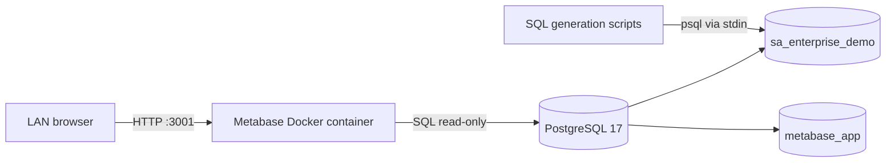
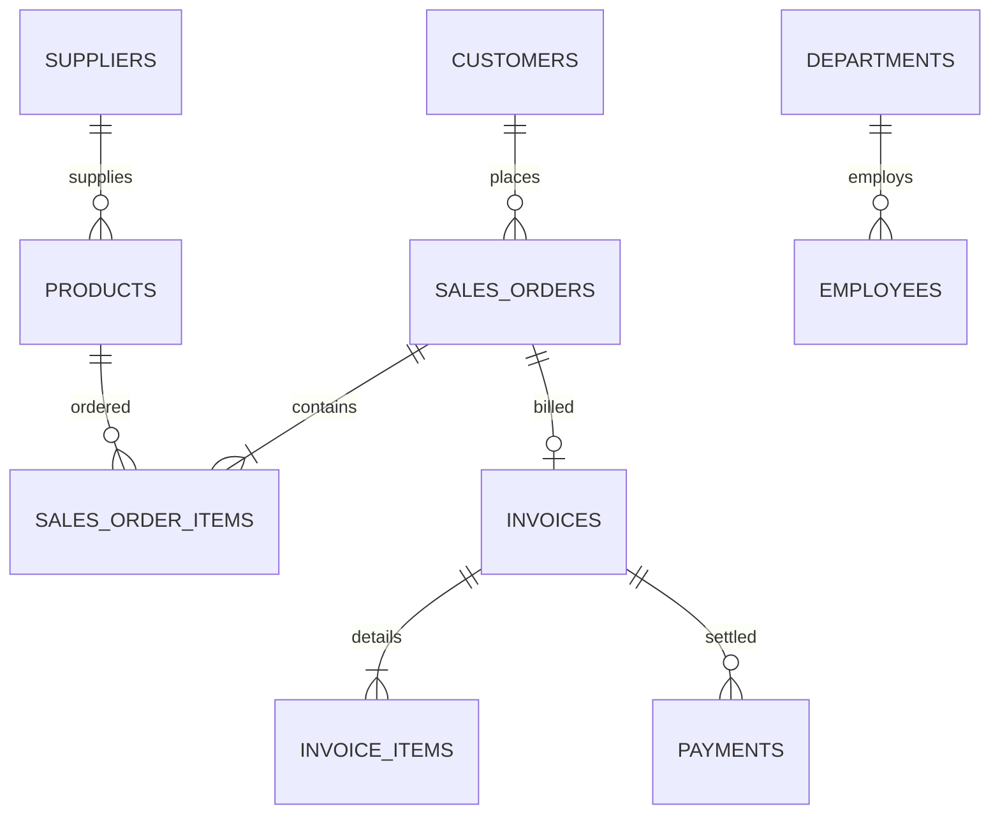

# 01 — Architecture and database schema

## Architecture

Host: Raspberry Pi 4, Debian 13, OpenMediaVault 8. The Metabase deployment used Docker and PostgreSQL as its application metadata store.

## Business entities

Relations in the live schema use `tbl_` prefixes. Core transactional keys include `sales_order_id`, `invoice_id`, `product_id`, and `customer_id`. Invoice numbers and payment references are unique; each invoice is associated with one sales order.

## Financial rules
- VAT applied at **15%** for this demonstration.
- Invoice total = subtotal + VAT.
- Item line total = quantity × unit price × (1 − discount percentage / 100), rounded to two decimals.
- Payments must be positive; permitted methods: EFT, Card, Cash, Bank Deposit.
- Invoice statuses: Draft, Issued, Partially Paid, Paid, Overdue, Cancelled.
- Sales order statuses: Draft, Confirmed, Processing, Dispatched, Completed, Cancelled.

## Reporting views
- `vw_monthly_sales`: month, invoice count, sales excluding VAT, output VAT, sales including VAT.
- `vw_vat_summary`: VAT month, invoice count, taxable sales, output VAT.
- `vw_customer_balances`: customer details, invoices, payments and outstanding amount.
- `vw_product_sales`: product, units sold, revenue excluding VAT, estimated cost and gross profit.

The four corresponding `view_*` aliases also existed. Metabase questions should reference an **active** relation rather than an inactive metadata entry.

This is an architectural description, not a full executable DDL export. Export the actual schema from the Pi to reproduce every column and constraint.
